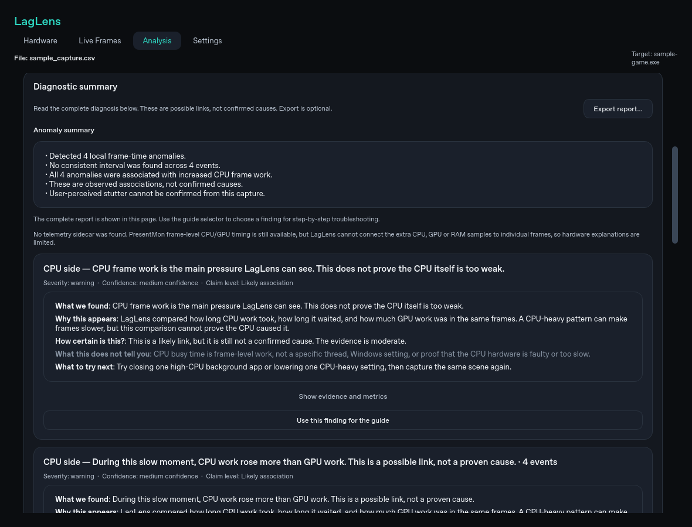

# LagLens

**LagLens is a free, open-source Windows frame-time capture and
evidence-based performance diagnostic tool.** It records PresentMon frame
data, optionally samples CPU/GPU telemetry, and turns the capture into a
plain-language diagnosis, technical evidence, and a step-by-step
troubleshooting guide.

LagLens is a diagnostic assistant, not a magic fix. It can point to
likely CPU, GPU, memory, presentation or data-quality problems based on
the captured evidence. It cannot guarantee that every stutter has been
found, and it does not change games, drivers or Windows settings.

Version **0.1.0** (source preview).

[简体中文](README_zh-CN.md) · [Changelog](CHANGELOG.md) ·
[Contributing](CONTRIBUTING.md) · [Third-party notices](packaging/THIRD_PARTY_NOTICES.txt)



## What it does

- Captures frame timing locally with the optional PresentMon 2.6.0 CLI.
- Shows live frame time, FPS and frame-time statistics while recording.
- Saves a CSV capture plus an optional telemetry sidecar for later
  analysis.
- Groups swap chains, detects local frame-time anomalies, and explains
  the evidence with a confidence/claim level.
- Presents a plain-language summary first, with a collapsible technical
  evidence section for users who want the raw details.
- Provides a four-step troubleshooting guide per finding, with local
  progress tracking.
- Exports the current analysis as Markdown or JSON.
- Keeps recent captures and settings locally; there is no cloud upload,
  account, telemetry upload or network sync.

## What it does not do

- It does not prove a root cause or guarantee a fix.
- It does not automatically change game settings, drivers, BIOS or
  Windows settings.
- It does not provide network diagnostics, automatic A/B testing, cloud
  analysis or AI-generated diagnoses.
- It does not support every game engine, overlay, capture method or
  abnormal display configuration.

## Features

- Single main window with **Hardware**, **Live Frames**, **Analysis** and
  **Settings** pages.
- Embedded Analysis page with frame-time chart, statistics, a complete
  inline diagnostic report, grouped findings, expandable evidence, event
  table, C-4 guide and optional report export.
- Analyze Last Capture, recent captures, automatic post-capture analysis
  and Open CSV all use the same Analysis page.
- Re-check prefills the target on the Live Frames page, verifies that the
  process is currently running, and never starts a capture automatically.
- English and Simplified Chinese UI switching at runtime.
- Dark, keyboard-friendly desktop UI with a 980×760 minimum window.
- Legacy `CPUStartTime` CSV support and opt-in QPC timestamp support.
- Missing telemetry, missing sidecars, damaged CSVs and older CSV formats
  degrade to clear warnings or limited analysis instead of crashing.

## Screenshots

The screenshots show the app analyzing a synthetic sample, not a real user recording.

| English | 简体中文 |
|---|---|
| [Analysis overview](docs/screenshots/analysis-en.png) | [分析概览](docs/screenshots/analysis-zh.png) |

[English diagnostic report](docs/screenshots/report-en.png)

## Requirements

- Windows 10 or Windows 11, x64.
- For ETW capture: an administrator account, or an account in the
  **Performance Log Users** group. PresentMon needs ETW access.
- Optional NVIDIA GPU telemetry: a compatible NVIDIA driver exposing
  NVML. Without it, the rest of LagLens still works.
- Python 3.12 to run this source preview.

## Install and run

No prebuilt LagLens ZIP has been published. [Run from source](#run-from-source).
To try the Analysis page without a game or ETW capture, open the included
synthetic `sample_capture.csv` from **Open CSV**. Download
[the optional PresentMon CLI](vendor/presentmon/README.md) only for live
capture or local Windows packaging.

## First capture

1. Open the **Live Frames** tab.
2. Select the running game process, or use **Select** to browse.
3. Choose the target FPS used for frame-time context.
4. Start monitoring, play the same scene for 30–120 seconds, then stop.
5. If the capture is complete and valid, LagLens switches to the
   **Analysis** tab automatically. You can also use **Analyze Last
   Capture**, a recent capture, or **Open CSV**.

ETW capture needs administrator access. LagLens does not elevate
silently: if the current process is not elevated, it explains the
requirement and asks before restarting with administrator rights. You can
also launch it from an elevated terminal or add your account to
`Performance Log Users`.

## Reading the diagnosis

The Analysis page is intentionally ordered from simple to technical:

1. **What was found** — a short summary in plain language.
2. **Why** — the main evidence and the claim level. A finding is a lead,
   not a proven root cause.
3. **Local dynamic anomalies** — moments that differ from nearby frames.
   Repeated timing patterns are reported only for the matching subset and
   are not presented as a cause.
4. **Technical evidence** — raw frame metrics, timebase/telemetry status,
   event details and the data behind the summary.
5. **What to try next** — conservative advice. Change one variable at a
   time and repeat the same scene when comparing results.

If the capture is incomplete, the page says so and limits the claims.
If telemetry is missing, the analysis uses the frame data and clearly
marks the missing hardware context.

## Using the step-by-step guide

Select a finding, then open the troubleshooting guide. Each finding has
a short checklist. Tick steps as you complete them; the page shows local
progress and a Reset button. Guide state is kept in memory for the
current session and is not uploaded.

The guide is a structured way to test hypotheses. It does not perform
the changes for you and does not claim that a step is guaranteed to fix
the stutter.

## QPC versus Relative time

PresentMon can emit two timestamp modes:

- **Legacy / Relative (`CPUStartTime`)** — the default and most widely
  compatible mode. LagLens treats it as a relative timebase.
- **QPC (`CPUStartQPCTime`, opt-in)** — a high-resolution timestamp that
  can be mapped to the host clock. LagLens verifies the mapping and
  labels the sync quality. QPC absolute milliseconds are never silently
  treated as relative milliseconds.

The QPC option is for users who need tighter time alignment with the
telemetry sidecar. Legacy CSV analysis remains supported, including old
files without a sidecar. See
[QPC integration notes](docs/C2_0_QPC_INTEGRATION.md) for details.

## Data and privacy

Packaged builds store settings, captures, telemetry sidecars and logs
under:

```text
%LOCALAPPDATA%\LagLens
```

`LAGLENS_DATA_DIR` can point to another writable folder for portable or
test use. Source checkouts keep captures under the repository’s
`captures/` folder, which is ignored by Git.

LagLens has no account system, no cloud sync and no capture upload. It
does not send telemetry. Reports use the capture basename and target
process name; they do not include the full user path. Treat captures as
potentially sensitive because they contain process names, timings and
optional hardware data.

## Run from source

Requires Windows, Python 3.12 and a virtual environment:

```powershell
git clone https://github.com/zhangyuzheng728-netizen/LagLens-Public.git LagLens
cd LagLens
py -3.12 -m venv .venv
.\.venv\Scripts\python.exe -m pip install -r requirements.txt
.\.venv\Scripts\python.exe main.py
```

Run the tests:

```powershell
.\.venv\Scripts\python.exe -m unittest discover -s tests -t .
```

## Build the Windows package

Place the [PresentMon CLI](vendor/presentmon/README.md) in its expected
location, then install the build dependencies and run the packaging script:

```powershell
.\.venv\Scripts\python.exe -m pip install -r requirements-build.txt
.\packaging\build_windows.ps1
```

Outputs:

```text
dist\LagLens\LagLens.exe
dist\LagLens-v0.1.0-win64.zip
dist\LagLens-v0.1.0-win64-files.txt
dist\LagLens-v0.1.0-win64.zip.sha256
```

Use `-DistRoot <folder>` to build somewhere else:

```powershell
.\packaging\build_windows.ps1 -DistRoot <build-folder>
```

The build uses PyInstaller `onedir`, bundles Qt platform plugins, the two
UI locales, SVG assets, PresentMon, and the license/notice files. The
build script rejects accidentally bundled CSVs, tests, captures and
development artifacts.

## Known limitations

- **Long recordings:** opening a long recording in Analysis can
  noticeably delay the UI. This was observed on a roughly 140,000-frame
  capture. Shorter captures can be used for a quicker first run.
- ETW capture requires administrator rights or membership in
  `Performance Log Users`; without either, live capture cannot start.
- PresentMon 2.6.0 is the expected CLI version. Other versions may
  produce different CSV columns or behavior.
- QPC mode is opt-in and its absolute mapping depends on the host clock;
  legacy Relative CSV remains the safe default.
- NVIDIA telemetry covers supported NVIDIA GPUs only. AMD/Intel GPU
  telemetry is not implemented.
- The current build is unsigned, so SmartScreen may warn.
- Diagnostics are evidence-based leads, not proof. VRR, overlays,
  multi-monitor DPI, capture-method changes and some anti-cheat/ETW
  restrictions are not fully validated.
- The C-4 checklist state is session-local; it is not saved into the
  report or restored after restarting LagLens.
- There is no network diagnostics, automatic A/B testing, cloud service
  or AI analysis.

## Third-party components and licenses

LagLens is distributed under the MIT License; see [LICENSE](LICENSE).
A locally built Windows package includes:

- **Qt / PySide6 / shiboken6 6.12.0** — LGPL-3.0-only, used under the
  LGPL option. Qt libraries are separate, replaceable DLLs/plugins.
- **PresentMon 2.6.0** — MIT, Intel Corporation.
- **psutil 7.2.2** — BSD-3-Clause.
- **nvidia-ml-py 13.615.71** — BSD-3-Clause; the NVML driver is not
  bundled.
- **Python 3.12 runtime** — Python Software Foundation License.
- **PyInstaller 6.16.0 bootloader** — GPL-2.0-or-later with the
  bootloader exception.
- **OpenSSL 3.0.15** — Apache-2.0 (runtime DLLs shipped with Python).
- **Microsoft Visual C++ runtime** — redistributed runtime DLLs under
  Microsoft’s redistributable terms.

Full texts and source links are in
[packaging/THIRD_PARTY_NOTICES.txt](packaging/THIRD_PARTY_NOTICES.txt)
and `packaging/LICENSES/`. The Qt source used by this build is available
from <https://code.qt.io/cgit/qt/> and
<https://code.qt.io/cgit/pyside/pyside-setup.git/>; LagLens does not
modify Qt.

## Contributing

Bug reports, diagnostic false-positive examples and documentation fixes
are welcome. Read [CONTRIBUTING.md](CONTRIBUTING.md) first. Do not attach
real captures without removing process names, account names and other
personal data.

## Disclaimer

LagLens is provided “as is”, without warranty of any kind. It reports
evidence and suggestions, not guaranteed fixes. You are responsible for
backing up your data and for any changes you make to your system, game or
drivers. LagLens does not operate game windows, change game settings or
elevate itself without your confirmation.
