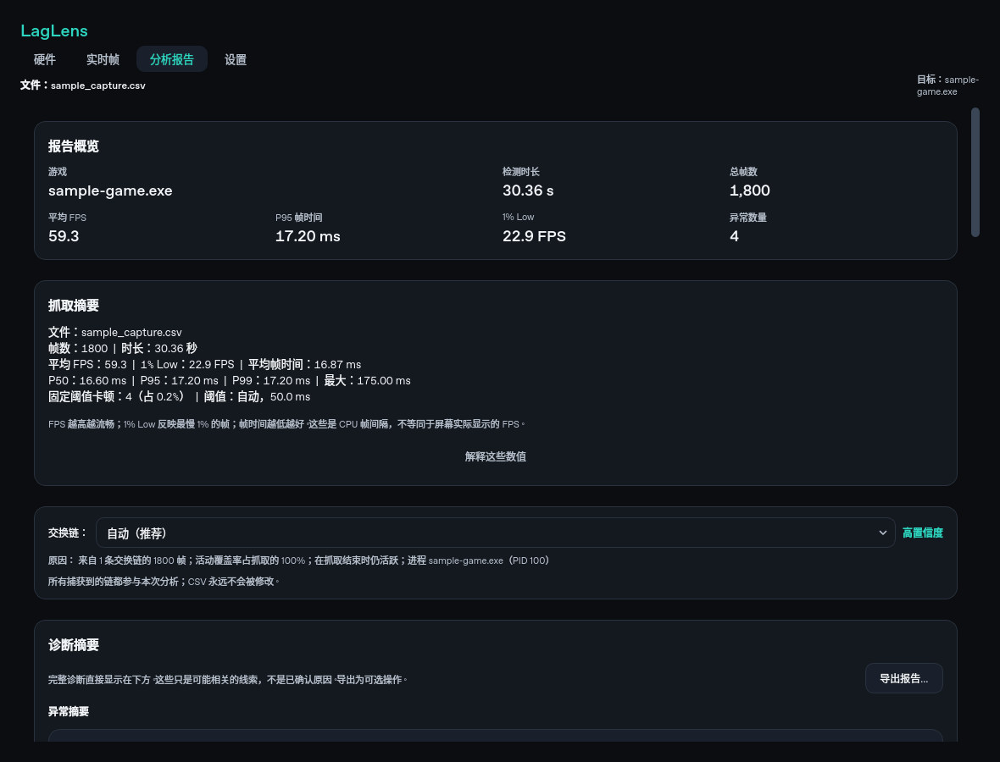

# LagLens

**LagLens 是一款免费、开源的 Windows 帧时间采集与证据化性能诊断工具。**
它通过 PresentMon 记录帧数据，可选采样 CPU/GPU 遥测，并把采集结果整理成
通俗诊断、技术证据和分步骤排查向导。

LagLens 是诊断助手，不是“一键修复”工具。它会根据采集到的证据指出可能的
CPU、GPU、内存、呈现或数据质量问题，但不能保证找到所有卡顿原因，也不会
自动修改游戏、驱动或 Windows 设置。

版本 **0.1.0**（源码预览版）。

[English](README.md) · [更新日志](CHANGELOG.md) ·
[参与贡献](CONTRIBUTING.md) · [第三方声明](packaging/THIRD_PARTY_NOTICES.txt)



## 主要功能

- 可选用 PresentMon 2.6.0 命令行工具在本机采集帧时间。
- 录制过程中显示实时帧时间、FPS 和帧时间统计。
- 保存 CSV 抓取文件，以及可选的硬件遥测 sidecar。
- 自动分组交换链，检测局部帧时间异常，并给出证据、置信度和结论级别。
- 默认先显示通俗摘要，技术证据可以折叠展开。
- 每个发现项提供四步排查向导，并在本地记录勾选进度。
- 支持导出 Markdown / JSON 报告。
- 最近检测记录和设置都保存在本机；没有账号、云端同步、遥测上传或网络同步。

## 不包含的功能

- 不证明唯一根因，也不保证修复卡顿。
- 不自动修改游戏、驱动、BIOS 或 Windows 设置。
- 不提供网络诊断、自动 A/B 测试、云端分析或 AI 诊断。
- 不保证覆盖所有游戏引擎、覆盖层、采集方式或异常显示配置。

## 界面与工作流

- 单主窗口，包含 **硬件 / 实时帧 / 分析报告 / 设置** 四个页面。
- 分析报告页内嵌帧时间图表、统计、完整诊断报告、分组发现、可展开证据、
  事件表、C-4 向导和可选的报告导出。
- “分析上次抓取”、最近检测、停止采集后的自动分析、打开 CSV 都进入同一个
  分析页面。
- 从分析页点击“重新检测”会返回实时帧页、预填目标，并重新检查进程是否
  正在运行；不会自动开始采集，也不会复用旧 PID。
- 支持中英文运行时切换、暗色主题和 980×760 最小窗口。
- 支持旧版 `CPUStartTime` CSV 和可选的 QPC 时间戳模式。
- 缺少遥测、缺少 sidecar、旧版 CSV 或损坏文件时，会降级为明确提示或受限
  分析，而不是直接崩溃。

## 截图

以下截图使用合成样本，不包含真实采集记录。

- [中文分析概览](docs/screenshots/analysis-zh.png)
- [英文分析概览](docs/screenshots/analysis-en.png)
- [英文诊断报告](docs/screenshots/report-en.png)

## 系统要求

- Windows 10 / Windows 11，x64。
- ETW 采集需要管理员权限，或账号属于 **Performance Log Users** 组。
- NVIDIA GPU 遥测是可选项，需要支持 NVML 的 NVIDIA 驱动。没有 NVML 时，
  其他功能仍可使用。
- 运行此源码预览版需要 Python 3.12。

## 安装与启动

目前尚未发布 LagLens 的预编译 ZIP，请参照下方「从源码运行」。
想直接体验分析页，可以用「打开 CSV」选择自带的合成样本
`sample_capture.csv`，不用启动游戏或做 ETW 采集。
只有实时采集或在本地构建 Windows 包时，才需要另行下载
[PresentMon 命令行工具](vendor/presentmon/README.md)。

## 进行一次游戏检测

1. 打开 **实时帧** 页面。
2. 选择正在运行的游戏进程，或点击 **选择** 浏览进程。
3. 设置用于帧时间上下文的目标 FPS。
4. 开始监控，在相同场景中游玩 30–120 秒，然后停止。
5. 如果抓取完整且有效，LagLens 会自动切换到 **分析报告** 页面。也可以使用
   “分析上次抓取”、最近检测记录或“打开 CSV”。

ETW 采集需要管理员权限。LagLens 不会静默提权；如果当前进程没有管理员
权限，它会解释原因，并在重新以管理员身份启动前询问。也可以从管理员终端
启动，或把账号加入 `Performance Log Users` 组。

## 如何阅读通俗诊断

分析页按“从简单到技术”的顺序组织：

1. **发现了什么**：用通俗语言给出简短摘要。
2. **为什么**：主要证据和结论级别。发现项是线索，不是已证明的根因。
3. **局部动态异常**：与附近帧相比明显不同的时刻。重复出现的时序模式只
   报告匹配的子集，不会被当作原因。
4. **技术证据**：原始帧指标、时间基准/遥测状态、事件详情和数据依据。
5. **可以尝试什么**：保守的建议。比较结果时一次只改变一个变量，并重复
   相同场景。

抓取不完整时，页面会明确说明，并限制结论范围。缺少遥测时，分析仍会使
用帧数据，并标明缺失的硬件上下文。

## 使用分步骤排查向导

选择一个发现项，然后打开排查向导。每个发现项都有一组简短检查步骤。完成
后勾选；页面显示本地进度和重置按钮。向导进度只保存在当前会话内，不会
上传。

向导是验证假设的结构化方法，不会替用户执行修改，也不声称某一步一定
能修复卡顿。

## QPC 与 Relative 的区别

PresentMon 可以输出两种时间戳模式：

- **旧版 / Relative（`CPUStartTime`）**：默认、兼容性最广。LagLens 将其
  视为相对时间基准。
- **QPC（`CPUStartQPCTime`，可选）**：高分辨率时间戳，可以映射到主机
  时钟。LagLens 会验证映射并标注同步质量。QPC 的绝对毫秒不会被静默当作
  相对毫秒使用。

需要与遥测 sidecar 更紧密对齐时可以使用 QPC。旧版 CSV（包括没有 sidecar
的文件）仍然支持。详见
[QPC 集成说明](docs/C2_0_QPC_INTEGRATION.md)。

## 数据与隐私

打包版本把设置、抓取文件、遥测 sidecar 和日志保存在：

```text
%LOCALAPPDATA%\LagLens
```

可以用 `LAGLENS_DATA_DIR` 指向其他可写文件夹，用于便携或测试。源码运行时
抓取文件位于仓库的 `captures/` 目录，该目录已被 Git 忽略。

LagLens 没有账号系统、云端同步或抓取上传，也不会发送遥测。报告使用抓取
文件名和目标进程名，不包含完整用户路径。抓取文件可能包含进程名、时序和
可选硬件数据，请按敏感数据处理。

## 从源码运行

需要 Windows、Python 3.12 和虚拟环境：

```powershell
git clone https://github.com/zhangyuzheng728-netizen/LagLens-Public.git LagLens
cd LagLens
py -3.12 -m venv .venv
.\.venv\Scripts\python.exe -m pip install -r requirements.txt
.\.venv\Scripts\python.exe main.py
```

运行测试：

```powershell
.\.venv\Scripts\python.exe -m unittest discover -s tests -t .
```

## 构建 Windows 发布包

把 [PresentMon 命令行工具](vendor/presentmon/README.md) 放到指定位置，再安装构建依赖并运行打包脚本：

```powershell
.\.venv\Scripts\python.exe -m pip install -r requirements-build.txt
.\packaging\build_windows.ps1
```

输出：

```text
dist\LagLens\LagLens.exe
dist\LagLens-v0.1.0-win64.zip
dist\LagLens-v0.1.0-win64-files.txt
dist\LagLens-v0.1.0-win64.zip.sha256
```

可用 `-DistRoot <文件夹>` 指定其他输出位置：

```powershell
.\packaging\build_windows.ps1 -DistRoot <build-folder>
```

构建使用 PyInstaller `onedir`，包含 Qt 平台插件、两个界面语言文件、SVG
资源、PresentMon 和许可证/声明文件。构建脚本会拒绝误打包的 CSV、测试、
抓取文件和开发产物。

## 已知限制

- **长记录**：打开长记录时，分析页面可能明显变慢。约 14 万帧的记录上已观察到
  这个问题。首次体验可以先用较短的记录。
- ETW 采集需要管理员权限或 `Performance Log Users` 组成员资格；否则无法
  开始实时采集。
- 实时采集预期使用 PresentMon 2.6.0。其他版本的 CSV 列和行为可能不同。
- QPC 模式是可选项，绝对映射依赖主机时钟；旧版 Relative CSV 仍是安全
  默认。
- NVIDIA 遥测只覆盖受支持的 NVIDIA GPU。尚未实现 AMD/Intel GPU 遥测。
- 当前构建未签名，SmartScreen 可能提示警告。
- 诊断是基于证据的线索，不是证明。VRR、覆盖层、多显示器 DPI、采集方式
  变化以及部分反作弊/ETW 限制尚未完整验证。
- C-4 勾选状态仅限当前会话，不会写入报告，也不会在重启后恢复。
- 没有网络诊断、自动 A/B 测试、云服务或 AI 分析。

## 第三方组件与许可证

LagLens 以 MIT License 分发；见 [LICENSE](LICENSE)。在本地构建的 Windows 包包含：

- **Qt / PySide6 / shiboken6 6.12.0** — LGPL-3.0-only，按 LGPL 选项使用。
  Qt 库以独立、可替换的 DLL/插件形式分发。
- **PresentMon 2.6.0** — MIT，Intel Corporation。
- **psutil 7.2.2** — BSD-3-Clause。
- **nvidia-ml-py 13.615.71** — BSD-3-Clause；不包含 NVML 驱动。
- **Python 3.12 运行时** — Python Software Foundation License。
- **PyInstaller 6.16.0 bootloader** — GPL-2.0-or-later，带 bootloader
  例外。
- **OpenSSL 3.0.15** — Apache-2.0（随 Python 分发的运行时 DLL）。
- **Microsoft Visual C++ 运行时** — 按 Microsoft 可再分发条款分发。

完整文本和源码链接见
[packaging/THIRD_PARTY_NOTICES.txt](packaging/THIRD_PARTY_NOTICES.txt)
和 `packaging/LICENSES/`。本构建使用的 Qt 源码可从
<https://code.qt.io/cgit/qt/> 和
<https://code.qt.io/cgit/pyside/pyside-setup.git/> 获取；LagLens 未修改 Qt。

## 参与贡献

欢迎提交缺陷报告、诊断误报样例和文档修正。请先阅读
[CONTRIBUTING.md](CONTRIBUTING.md)。不要直接上传包含真实进程名、账号名或
其他个人数据的抓取文件。

## 免责声明

LagLens 按“原样”提供，不附带任何明示或暗示担保。它提供证据和建议，不保证
修复问题。你需要自行备份数据，并对系统、游戏或驱动所做的修改负责。
LagLens 不会操作游戏窗口、修改游戏设置，也不会在未经确认的情况下自动提权。
